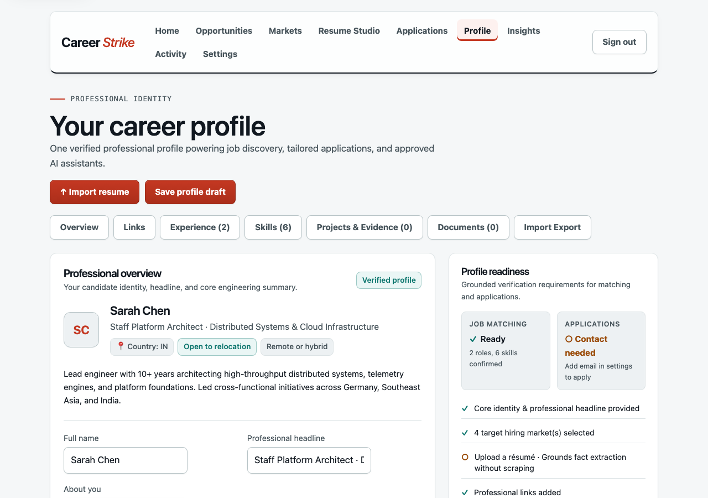
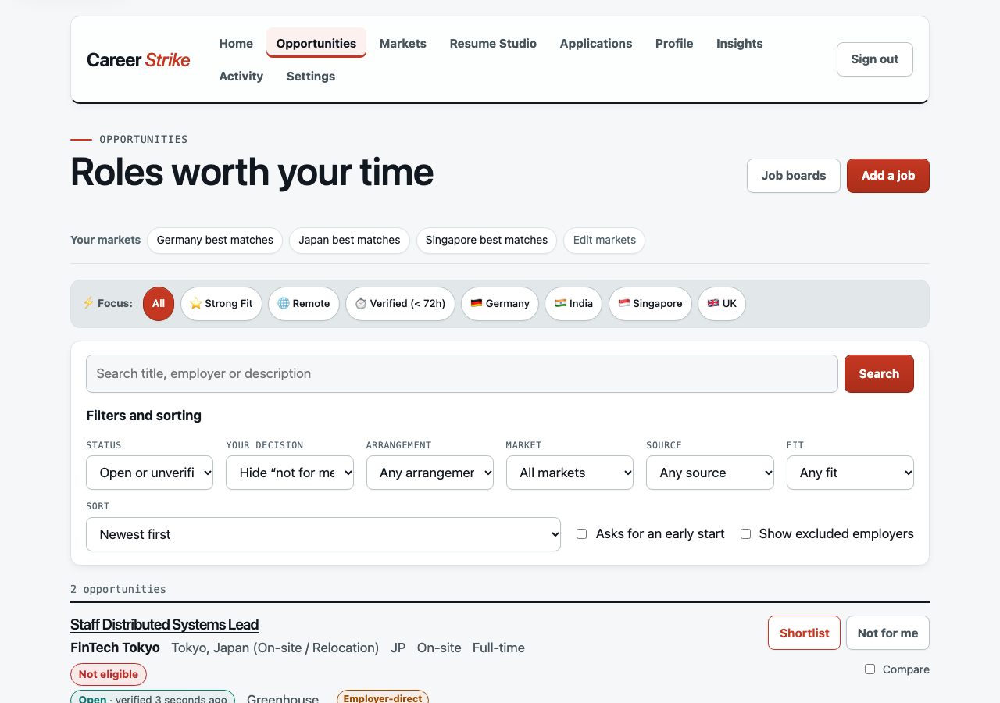
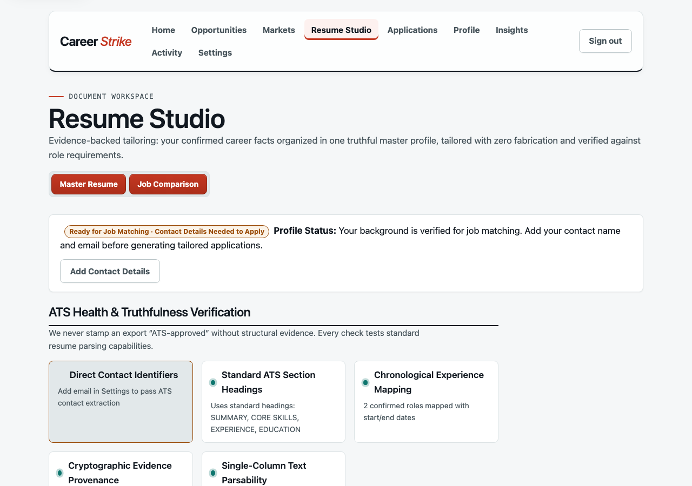
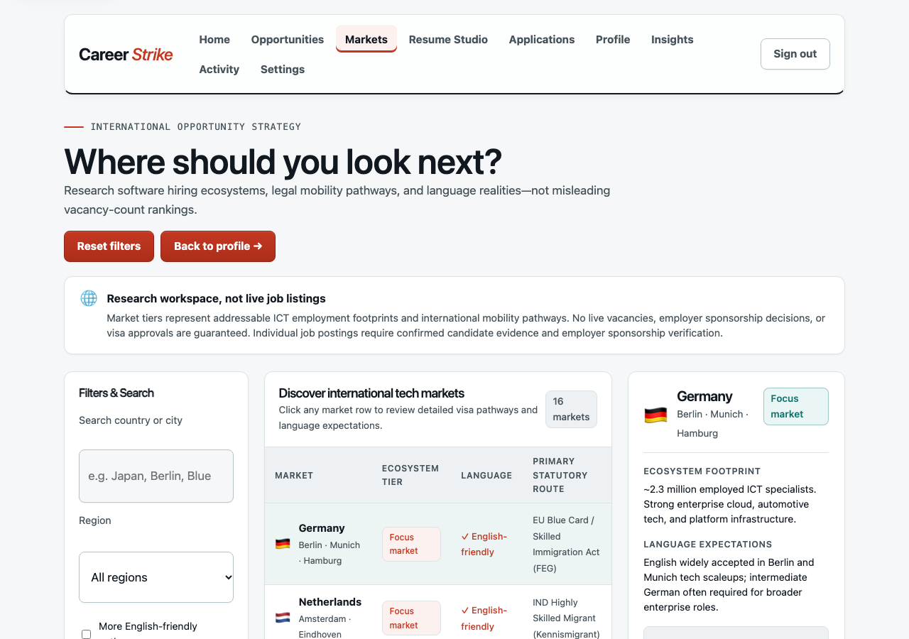
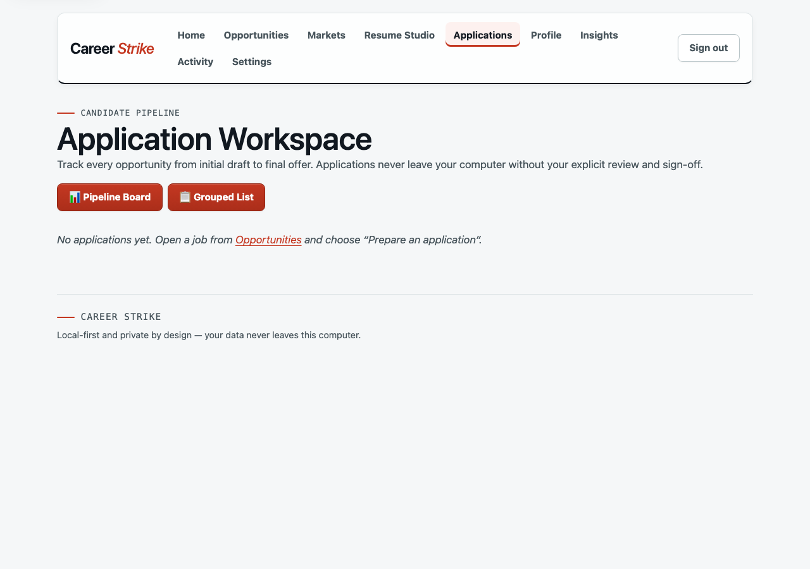
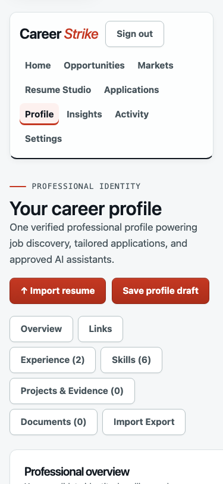

# Career Strike

### Your next career move, made simpler.

**Find opportunities. Understand your strengths. Prepare better applications. Move forward with confidence.**

[](CHANGELOG.md)
[](LICENSE)
[](docs/privacy.md)
[](docs/job-hunt-guide.md#optional-connect-an-ai-assistant)

Career Strike is a private, local-first workspace designed to guide IT professionals through every stage of their job search—from discovering verified openings to preparing evidence-backed applications and tracking interviews.

Whether you are a **Software Engineer**, **Product Manager**, **Business Analyst**, **QA & Test Engineer**, **Data Analyst**, **Cloud & DevOps Engineer**, **UI/UX Designer**, **IT Support Specialist**, **Cybersecurity Professional**, **Technical Writer**, **Customer Success / Solutions Architect**, or a **Career Changer**, Career Strike helps you take control of your career journey without surrendering your private data to third-party clouds or automated application spam.

---

## Jump To

- [Interactive Candidate Welcome](#the-interactive-candidate-welcome)
- [How Career Strike Works](#how-career-strike-works)
- [Verified Product Capabilities](#verified-product-capabilities)
- [Feature Showcase](#feature-showcase)
- [Explore Opportunities Worldwide](#explore-opportunities-worldwide)
- [LinkedIn Profile & Data Integration](#linkedin-profile--data-integration)
- [Get Started — No Coding Required](#get-started--no-coding-required)
- [Optional: Connect an AI Assistant](#optional-connect-an-ai-assistant)
- [Candidate Trust & Data Privacy](#candidate-trust--data-privacy)
- [Frequently Asked Questions](#frequently-asked-questions)
- [Developer Reference & Commands](#developer-reference--commands)
- [Documentation & Guides](#documentation--guides)
- [License](#license)

---


_Figure 1: The Career Strike Candidate Profile Workspace. A single, evidence-backed source of truth for your summary, skills, experience, and mobility preferences._

---

## The Interactive Candidate Welcome

Starting a job search can feel overwhelming. Career Strike includes a dedicated 4-step onboarding experience to help you clarify your path before opening a single vacancy:

| Step       | Question                           | What You Choose                                                                                                                                    | Why It Matters                                                                              |
| :--------- | :--------------------------------- | :------------------------------------------------------------------------------------------------------------------------------------------------- | :------------------------------------------------------------------------------------------ |
| **Step 1** | **What do you do?**                | Select your IT discipline (e.g. Business Analyst, Software Engineer, Product Manager, QA) or enter your exact headline.                            | Tailors the keywords and skill requirements used during job discovery and match evaluation. |
| **Step 2** | **Where would you like to work?**  | Choose your working arrangement (Remote, Local, or Relocation) and select target countries (e.g. Germany, Netherlands, Ireland, Singapore, Japan). | Eliminates roles with incompatible residency, sponsorship, or location constraints.         |
| **Step 3** | **What would you like help with?** | Identify your immediate priority: finding verified openings, reviewing resume claims, exploring visa pathways, or preparing tailored applications. | Directs your initial focus so you make steady progress without unnecessary distraction.     |
| **Step 4** | **Get your personalized plan**     | Generate a customized job-search strategy plan with target roles, curated employer feeds, statutory visa realities, and next steps.                | Provides a clear starting plan and a ready-to-use prompt for your chosen AI assistant.      |

> [!TIP]
> **Try the Interactive Welcome in Your Browser**: You can explore the interactive 4-step welcome experience right now with sample data. Open [`docs/candidate-welcome.html`](docs/candidate-welcome.html) in any browser. It runs 100% locally with zero installation.

---

## How Career Strike Works

Career Strike organizes your job hunt into a deliberate, candidate-controlled journey:

```text
Create Your Profile ──> Discover Jobs ──> Understand Match ──> Prepare Application ──> Apply ──> Track Progress
```

Every stage is built around candidate agency and factual transparency:

| Stage           | What You Do                                                               | What Career Strike Does                                                                  | Required Information                         | AI Involvement              | Candidate Approval                                 |
| :-------------- | :------------------------------------------------------------------------ | :--------------------------------------------------------------------------------------- | :------------------------------------------- | :-------------------------- | :------------------------------------------------- |
| **1. Profile**  | Add your skills, work history, target roles, and location preferences.    | Organizes your background into an evidence-backed career record. Highlights gaps.        | Resume (optional), core skills, past titles. | None by default.            | You approve every saved fact.                      |
| **2. Discover** | Add public employer career pages (Greenhouse, Lever, Ashby) to monitor.   | Automatically retrieves active postings directly from the employer's official feed.      | Board URL or employer name.                  | None.                       | You decide which boards to follow.                 |
| **3. Match**    | Review postings and filter by location, remote policy, and fit tier.      | Compares job requirements against your confirmed profile facts and quotes employer text. | Stored profile facts + posting text.         | None (deterministic rules). | You decide to Shortlist or Exclude.                |
| **4. Prepare**  | Open a shortlisted role and generate tailored resume/cover letter drafts. | Aligns your actual accomplishments to the role's requirements without inventing claims.  | Target job + your approved experience.       | Optional local drafting.    | You review and cryptographically sign the package. |
| **5. Apply**    | Visit the employer's official portal and submit the application yourself. | Keeps your signed package ready for reference; never spams employers for you.            | Employer application link.                   | None.                       | You perform and confirm the submission.            |
| **6. Track**    | Record interview dates, export calendar invites (`.ics`), and follow up.  | Maintains your kanban pipeline, schedules reminders, and generates outreach drafts.      | Status updates, interview notes.             | Optional draft generation.  | You approve all communications.                    |

---

## Verified Product Capabilities

We believe in complete product truth. The table below outlines the exact implementation status of all Career Strike capabilities based on the repository test suite and acceptance registry:

| Capability                               |   Status    | Implementation Details & Evidence                                                                                                                                                                |
| :--------------------------------------- | :---------: | :----------------------------------------------------------------------------------------------------------------------------------------------------------------------------------------------- |
| **Local-First Privacy**                  | `AVAILABLE` | Service and SQLite database bind strictly to `127.0.0.1`. No telemetry, analytics, or cloud accounts ([`docs/privacy.md`](docs/privacy.md)).                                                     |
| **Candidate Profile Workspace**          | `AVAILABLE` | Human-crafted career profile view with inline editing, headline, summary, links, and evidence tags ([`Profile`](src/web/pages/Profile/index.tsx)).                                                 |
| **Resume Document Storage**              | `AVAILABLE` | Upload and local storage for PDF and DOCX files in the user's private data folder ([`docs/job-hunt-guide.md`](docs/job-hunt-guide.md)).                                                          |
| **LinkedIn Archive (Zip/CSV) Import**    | `AVAILABLE` | Client-side parsing of candidate-provided LinkedIn export files (`Positions.csv`, `Skills.csv`, `Education.csv`) with conflict review.                                                           |
| **Direct Employer Job Discovery**        | `AVAILABLE` | Automated polling of official public Greenhouse, Lever, and Ashby career feeds ([`docs/install.md`](docs/install.md)).                                                                           |
| **Manual Opportunity Recording**         | `AVAILABLE` | Add unlisted roles from any source; explicitly tagged `UNVERIFIED` until verified.                                                                                                               |
| **Evidence-Backed Match Evaluation**     | `AVAILABLE` | Deterministic fit scoring (`EXCELLENT`, `STRONG`, `MODERATE`, `BASIC`) derived from verified facts and quoted employer text.                                                                     |
| **Application Pipeline & Kanban**        | `AVAILABLE` | Full stage tracking: Saved, Shortlisted, Prepared, Approved, Submitted, Follow-up, Interviewing, Offer, Closed.                                                                                  |
| **Tailored Document Studio**             | `AVAILABLE` | Evidence-backed resume and cover-letter draft generation with side-by-side claim comparison ([`docs/document-personalization.md`](docs/document-personalization.md)).                            |
| **Cryptographic Application Approval**   | `AVAILABLE` | HMAC-SHA256 signature locks the exact approved application version; any edit invalidates approval.                                                                                               |
| **Automated Real-Employer Submissions**  |  `PLANNED`  | **Intentionally disabled.** Candidates submit on official employer portals. Automated submission is tested _only_ against the local practice ATS ([`docs/limitations.md`](docs/limitations.md)). |
| **Interview Prep & STAR Coaching**       | `AVAILABLE` | STAR behavioral prompt generator based on role requirements and confirmed candidate accomplishments.                                                                                             |
| **Interview iCalendar (.ics) Export**    | `AVAILABLE` | Generates RFC-5545 compliant `.ics` calendar files for scheduled interview stages.                                                                                                               |
| **Outreach Draft Studio**                | `AVAILABLE` | Contextual follow-up email drafts for status checks, post-interview thank-you notes, and offer next steps.                                                                                       |
| **Global Market Explorer Matrix**        | `AVAILABLE` | 16-country research matrix with statutory visa pathways, language expectations, and official policy citations.                                                                                   |
| **Model Context Protocol (MCP) Server**  | `AVAILABLE` | Stdio MCP server with 11 scoped tools for optional integration with Claude Code, Codex, and OpenCode.                                                                                            |
| **Single-Use Personal Info Disclosures** | `AVAILABLE` | AI assistants request specific fields with a stated purpose; you preview and approve exact values in the dashboard.                                                                              |
| **Data Export, Backup & Rollback**       | `AVAILABLE` | CLI commands for transactional export, backup, restore, and pre-upgrade rollback.                                                                                                                |
| **Permanent Data Erasure**               | `AVAILABLE` | Single-command complete wipe of local databases, documents, and OS keychain items.                                                                                                               |

---

## Feature Showcase

### 1. Candidate Career Profile

The default profile view is designed as a calm, professional career workspace rather than an intimidating registration form.

- **Identity & Summary**: Maintain your professional headline, narrative summary, and primary competencies.
- **Verified Skills**: Distinguish skills confirmed by your experience from unconfirmed suggestions.
- **Career Preferences**: Set role preferences, working arrangements (Remote, Hybrid, Onsite), and target countries.
- **Professional Evidence**: Link verified portfolio repositories and document versions without sharing them externally.

---

### 2. Smart Job Discovery

Career Strike bypasses noisy job aggregators and stale scraping by connecting directly to official applicant tracking systems (ATS):


_Figure 2: Job discovery displaying direct employer postings, salary disclosure transparency, and evidence-backed fit tiers._

- **Direct Employer Feeds**: Follow company career boards powered by Greenhouse, Lever, or Ashby.
- **Freshness Guarantees**: Postings verified within 72 hours are marked `OPEN`; inactive postings transition to `STALE` or `CLOSED`.
- **Honest Match Explanations**: Fit tiers explain _why_ a role matches your profile, quoting exact employer requirements alongside your saved experience.
- **Manual Role Intake**: Found a job on an external board or through a referral? Add it manually—Career Strike tracks it transparently as `UNVERIFIED`.

---

### 3. Resume & Cover Letter Studio

Create tailored application documents without hallucinated qualifications or generic AI filler:


_Figure 3: Tailored document drafting with side-by-side fact verification and candidate approval locking._

- **Evidence-Backed Drafts**: Tailored resumes and cover letters draw strictly from confirmed profile facts.
- **Side-by-Side Review**: Compare draft statements against employer requirements and your master profile before accepting changes.
- **Candidate Approval Lock**: Approving an application cryptographically signs the package. Editing any field clears the approval so you never accidentally submit outdated content.
- **Document Export**: Export your approved drafts in clean, readable formats ready for submission.

---

### 4. Global Career Explorer

Research international technology markets with grounded, evidence-backed clarity:


_Figure 4: International market matrix displaying statutory immigration pathways, language expectations, and tech ecosystems._

- **No Artificial Rankings**: Countries are categorized by ecosystem depth, language fit, and immigration feasibility—not arbitrary vacancy counts.
- **Statutory Pathway Realities**: Clear references to real visa frameworks (e.g. EU Blue Card in Germany, Critical Skills Employment Permit in Ireland, COMPASS points in Singapore).
- **Language Expectations**: Highlights where English is standard in tech teams versus where local language fluency (e.g. Japanese JLPT N2/N1) is expected.
- **Target Market Shortlisting**: Select target countries to automatically prioritize relevant openings in your discovery feed.

---

### 5. Application Pipeline & Interview Coaching

Keep all your active opportunities organized in one unified workflow:


_Figure 5: Candidate pipeline tracking applications from draft through submission, interview scheduling, and offer stages._

- **Structured Stages**: Track roles across Draft, Shortlisted, Prepared, Approved, Submitted, Follow-up, Interviewing, and Offer.
- **STAR Interview Coaching**: Generate behavioral interview preparation prompts based on the employer's quoted requirements and your confirmed projects.
- **iCalendar (.ics) Sync**: Export scheduled interview dates directly into Apple Calendar, Google Calendar, or Outlook.
- **Outreach Studio**: Generate courteous, professional follow-up drafts for status checks, post-interview thank-you notes, and offer discussions.

---

### 6. Responsive Mobile Experience

Career Strike is designed to adapt gracefully to mobile screens for reviewing opportunities and updating application status on the go:

<p align="center">
  
  <br />
  <em>Figure 6: Candidate profile and navigation optimized for 375px mobile viewports without horizontal scrolling.</em>
</p>

---

## Explore Opportunities Worldwide

Career Strike provides dedicated research and discovery guides for major global technology ecosystems:

### Europe

- [**Germany**](docs/germany-job-discovery.md) (`DE`): Largest EU ICT employment footprint (~2.3M specialists). Strong cloud, enterprise software, and automotive tech. Statutory pathway: EU Blue Card / Skilled Immigration Act (FEG).
- [**United Kingdom**](docs/uk-job-discovery.md) (`GB`): Major English-speaking market with deep venture capital, fintech, and AI ecosystems. Statutory pathway: Skilled Worker Visa (Licensed Sponsor).
- **Netherlands** (`NL`): High English fluency; major semiconductor, fintech, and multinational European engineering hubs. Statutory pathway: IND Highly Skilled Migrant (Kennismigrant).
- **Ireland** (`IE`): European headquarters for global software and cloud infrastructure leaders. Statutory pathway: DETE Critical Skills Employment Permit (CSEP).
- **Nordics & Central Europe**: Coverage and research for Finland (`FI`), Sweden (`SE`), Poland (`PL`), Czechia (`CZ`), Estonia (`EE`), and Portugal (`PT`).

### Asia & Middle East

- [**India**](docs/india-job-discovery.md) (`IN`): Global Innovation Centers (GCCs), enterprise tech platforms, and high-growth engineering scaleups across Bengaluru, Hyderabad, and Pune.
- [**Singapore**](docs/singapore-job-discovery.md) (`SG`): Premier Southeast Asian regional headquarters hub for fintech and global enterprise tech. Statutory pathway: MOM Employment Pass (evaluated via COMPASS criteria).
- [**Japan**](docs/japan-job-discovery.md) (`JP`): Major robotics, e-commerce, and gaming sectors. English roles concentrate in international scaleups; Japanese fluency significantly widens opportunities. Statutory pathway: Engineer / Specialist in Humanities.
- [**Southeast Asia**](docs/southeast-asia-job-discovery.md): Regional tech discovery across Malaysia (`MY`), Indonesia (`ID`), the Philippines (`PH`), Thailand (`TH`), and Vietnam (`VN`).
- [**United Arab Emirates**](docs/uae-job-discovery.md) (`AE`): Rapidly expanding tech hub across Dubai and Abu Dhabi for cloud, AI, and fintech. Statutory pathway: MoHRE Skilled Worker / Green Visa.

### North America & Oceania

- [**Canada**](docs/canada-job-discovery.md) (`CA`): AI research clusters and North American tech engineering centers.
- [**Australia**](docs/australia-job-discovery.md) (`AU`): Enterprise SaaS, tech unicorns, and regional technology hubs across Sydney and Melbourne.

---

## LinkedIn Profile & Data Integration

Career Strike treats LinkedIn as a complementary source of candidate-provided facts, not an invasive data pipeline:

1. **Adding Your LinkedIn URL**: You can record your public LinkedIn profile link (`https://linkedin.com/in/your-profile`) in your profile. Career Strike validates the URL syntax for formatting; it **never** claims this verifies profile ownership.
2. **Importing Your Profile Archive**: You can download your official data archive from LinkedIn (Settings → Data Privacy → Get a copy of your data) and import `Positions.csv`, `Skills.csv`, and `Education.csv` directly into Career Strike.
3. **Candidate Review & Confirmation**: Imported records appear as _proposed suggestions_. Career Strike displays conflicts with your existing facts and requires your explicit approval before adding any item to your canonical profile.
4. **Zero Scraping, Zero Credential Risk**: Career Strike **never** asks for your LinkedIn username or password, never runs background scraping bots, and never violates platform terms.

---

## Get Started — No Coding Required

Career Strike runs locally on your computer to keep your career data 100% private. Getting started requires only a few simple steps:

### 1. Install Career Strike

You need **Node.js 22.12 or later** on macOS or Linux (Windows works with WSL).

Install the latest release with one command:

```bash
npm install --global https://github.com/<owner>/career-strike/releases/latest/download/career-strike.tgz
```

_(To build from source instead, see [docs/install.md](docs/install.md).)_

### 2. Initialize and Open Your Private Dashboard

```bash
career-strike init
career-strike dashboard
```

`career-strike dashboard` starts the local background service if needed and opens your private, authenticated dashboard in your default browser. The sign-in link is single-use, protecting your session even if someone inspects your browser history.

### 3. Build Your Professional Profile

Open **Profile** in the navigation bar. Enter your headline, narrative summary, target roles, and location preferences. Upload an existing resume (PDF or DOCX) to extract and confirm your core skills and past experience.

### 4. Add Job Boards & Discover Roles

Visit **Opportunities → Job boards**. Add the Greenhouse, Lever, or Ashby careers URL for companies you want to track (e.g. `https://jobs.lever.co/company` or `https://boards.greenhouse.io/company`). Click **Fetch now** to collect verified openings immediately.

### 5. Shortlist, Prepare & Apply

- Open an opportunity to review the employer's quoted requirements and your match evaluation.
- Click **Shortlist** to save it to your pipeline.
- Click **Prepare an application** to generate tailored resume and cover-letter drafts.
- Review and approve the final package.
- Open the employer's official posting, submit your application, and confirm submission in Career Strike to update your pipeline.

---

## Optional: Connect an AI Assistant

> [!IMPORTANT]
> **Career Strike is 100% standalone.** You do not need an AI assistant to use any feature in Career Strike. Everything runs directly from the built-in web dashboard.

If you already use an AI assistant like **Claude Code**, **Codex**, or **OpenCode**, you can optionally connect it to Career Strike using the [Model Context Protocol (MCP)](https://modelcontextprotocol.io/):

### Connect with One Command

```bash
# Connect Claude Code
career-strike connect claude-code

# Connect Codex
career-strike connect codex

# Connect OpenCode
career-strike connect opencode
```

For other MCP-compatible clients (e.g. Cursor, Windsurf):

```bash
career-strike authorize-mcp my-client
# Configure the client to launch: career-strike mcp --client my-client
```

### Strict Privacy Invariants for AI Assistants

Career Strike treats AI assistants as untrusted external agents:

- **Public Data Only by Default**: Connected assistants can only search public job postings, read posting text, and suggest adding public job boards.
- **No Document or Contact Access**: Assistants **never** receive your resume documents, contact details, or email addresses—even if requested.
- **Single-Use Scoped Disclosures**: If an assistant needs parts of your profile (e.g. past job titles to suggest a search query), it must submit a request with a stated purpose. You review the exact values in the dashboard and approve or deny the request. Each approved disclosure can be collected once within one hour.
- **No Automated Actions**: Assistants can **never** approve an application, edit an approved package, or submit an application on your behalf.

To disconnect an assistant at any time:

```bash
career-strike disconnect claude-code
```

---

## Candidate Trust & Data Privacy

Your job search is one of the most sensitive activities in your professional life. Career Strike is engineered with privacy as a foundational requirement:

- **Local Storage Only**: All candidate data, resumes, applications, and notes are stored in your user application data directory (`~/Library/Application Support/career-strike` on macOS or `~/.local/share/career-strike` on Linux).
- **Local Network Binding**: The local web server and API listen strictly on `127.0.0.1`. Nothing is exposed to the local network or internet.
- **Zero Cloud Accounts or Telemetry**: There is no Career Strike cloud, no account registration, no telemetry, no tracking cookies, and no analytics.
- **Full Data Ownership & Portability**:
  - Export all your data and documents anytime: `career-strike export ./my-career-backup`
  - Back up or restore your complete workspace: `career-strike backup ./backup-folder`
  - Complete, verifiable data erasure: `career-strike delete-data --confirm "delete my career data"` permanently deletes all databases, documents, and keychain secrets.

For complete details on network permissions and security invariants, see the [Career Strike Privacy and Security Model](docs/privacy.md).

---

## Frequently Asked Questions

#### Do I need to know coding or programming to use Career Strike?

No. Career Strike is built for all IT professionals, including Business Analysts, Product Managers, QA Engineers, Data Analysts, UI/UX Designers, and IT Support Specialists. Once launched, all everyday tasks—profile building, job discovery, resume tailoring, and application tracking—take place entirely in the graphical web dashboard.

#### Can Business Analysts and Product Managers use Career Strike?

Yes. Career Strike evaluates job requirements against whatever skills, domains, and accomplishments you confirm in your profile. It works equally well matching Agile methodologies, stakeholder management, and product metrics as it does programming languages.

#### Can I upload my existing resume?

Yes. You can upload PDF and DOCX resume documents. Career Strike extracts your text and suggests facts (skills, past titles, education) for your review. It never silently invents qualifications or assumes unconfirmed claims are true.

#### Can I connect my LinkedIn profile?

You can record your public LinkedIn profile URL and import your official LinkedIn data archive (Positions, Skills, and Education CSVs). Career Strike checks URLs for formatting and lets you review imported history before adding it to your profile. It never asks for your LinkedIn password and never scrapes LinkedIn pages.

#### Can Career Strike find remote jobs?

Yes. You can filter opportunities by working arrangement (Remote, Hybrid, Onsite). Career Strike also distinguishes between remote roles open globally versus remote roles restricted to specific national tax jurisdictions.

#### Can Career Strike help me find jobs in Germany, the UK, Singapore, or Japan?

Yes. Career Strike includes curated market intelligence and direct employer boards across 16 countries in Europe, Asia, and the Middle East, along with statutory visa guidelines and language expectations.

#### Will Career Strike apply for jobs automatically without my permission?

No. Career Strike never submits real-world applications or messages recruiters on your behalf. You review and approve your application package in the dashboard, open the employer's official website, and submit it yourself.

#### Does Career Strike guarantee job offers or interviews?

No. Career Strike is a local productivity and intelligence tool. It does not promise interviews, manipulate applicant tracking systems, or make unrealistic claims. It helps you find relevant roles faster, tailor honest applications, and stay organized.

#### Do I need Claude Code, Codex, or ChatGPT to use Career Strike?

No. Career Strike is 100% standalone. AI assistants are optional helpers that connect locally over MCP only if you choose to connect them.

#### Where is my data stored?

All data is stored exclusively on your own computer in a local SQLite database and protected filesystem directory. No data is ever sent to a Career Strike cloud server.

#### Is Career Strike free and open-source?

Yes. Career Strike is free, open-source software licensed under the [Apache 2.0 License](LICENSE).

#### How do I delete my data if I no longer need it?

Run `career-strike delete-data --confirm "delete my career data"`. This command permanently removes your SQLite database, documents, and system keychain credentials from your computer.

---

## Developer Reference & Commands

For engineers, administrators, and power users, the `career-strike` CLI provides complete lifecycle control:

| Command                                        | Description                                                                                         |
| :--------------------------------------------- | :-------------------------------------------------------------------------------------------------- |
| `career-strike dashboard`                      | Starts the detached background service if needed and opens your private dashboard.                  |
| `career-strike doctor`                         | Validates local directories, permissions, Node.js version, and dependencies without altering state. |
| `career-strike start` / `stop`                 | Starts or stops the background service process.                                                     |
| `career-strike status`                         | Checks whether the local service is currently running and reports its port and PID.                 |
| `career-strike connect <assistant>`            | Connects an AI assistant (`codex`, `claude-code`, or `opencode`) via MCP.                           |
| `career-strike disconnect <assistant>`         | Unregisters an AI assistant and revokes its local credentials.                                      |
| `career-strike authorize-mcp <client>`         | Issues a scoped local token for a generic MCP client.                                               |
| `career-strike revoke-mcp <client>`            | Revokes an MCP client token.                                                                        |
| `career-strike practice`                       | Boots an owned local test ATS server to safely rehearse application preparation and submission.     |
| `career-strike verify-market <CC>`             | Verifies permitted job-board retrieval for a country before marking it discovery-available.         |
| `career-strike export <dir>`                   | Exports all career records and documents as readable JSON and files.                                |
| `career-strike backup <dir>` / `restore <dir>` | Creates or restores a full transactional backup of the workspace.                                   |
| `career-strike rollback`                       | Restores the database from the pre-upgrade snapshot if an update needs to be undone.                |
| `career-strike update`                         | Downloads the latest verified release, verifies checksums, tests execution, and updates safely.     |
| `career-strike uninstall`                      | Unregisters all MCP connections and removes the globally installed binary.                          |
| `career-strike delete-data`                    | Permanently deletes all local career data, documents, and secrets with confirmation phrase.         |

### Development & Testing

```bash
# Install development dependencies
npm install

# Run type checks and build
npm run typecheck
npm run build

# Run unit and integration tests (Vitest)
npm test

# Run end-to-end tests (Playwright)
npx playwright test
```

---

## Documentation & Guides

- [**Installing, Updating, and Troubleshooting**](docs/install.md): Full guide to prerequisites, updates, and environment options.
- [**Practical Job-Hunt Guide**](docs/job-hunt-guide.md): Step-by-step first session, daily routine, and search strategies.
- [**Privacy and Security Model**](docs/privacy.md): In-depth network rules, assistant permissions, and local storage guarantees.
- [**Tailored Résumé and Cover-Letter Drafts**](docs/document-personalization.md): Personalization engine and factual alignment rules.
- [**Known Limitations**](docs/limitations.md): Clear documentation of current platform boundaries and verified source limits.
- [**Interactive Candidate Welcome**](docs/candidate-welcome.html): Standalone browser onboarding guide and plan generator.

---

## License

Career Strike is licensed under the [Apache License, Version 2.0](LICENSE).
